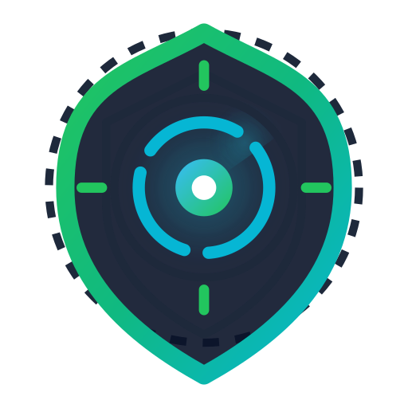
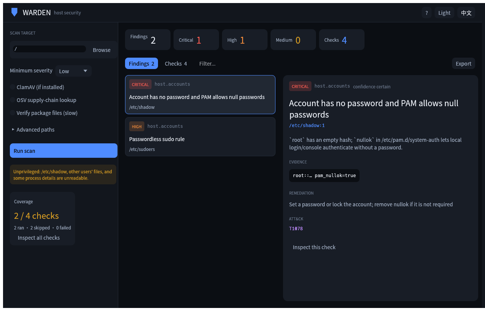
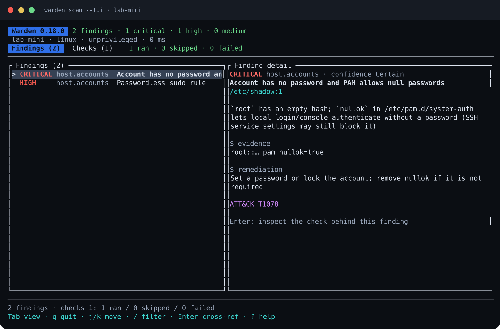

<div align="center">



# Warden

**Read-only host security scanner for macOS and Linux.**

Persistence, privilege, listeners, signatures, and supply-chain risk — with a native GUI, a terminal UI, a CLI, and a Linux sandbox.

[English](README.md) · [简体中文](README.zh-CN.md)

[](LICENSE)
[](https://www.rust-lang.org)
[](#platforms)

</div>

## Screenshots

<p align="center">
  
  <br />
  <em>Native desktop app — findings, evidence, and coverage on macOS and Linux.</em>
</p>

<p align="center">
  
  <br />
  <em>The same report in the terminal UI: findings and the full checks/coverage view.</em>
</p>

## What it does

Warden looks for the things attackers actually use to stay on a Unix host: persistence, privilege escalation, exposed listeners, dangerous account configuration, tampered packages, webshells, and known-bad indicators. Every finding carries evidence — a path, line, command, hash, or package version.

It is deliberately **not** a signature-only antivirus, an EDR, or a real-time protector. It does not auto-remediate, quarantine, or kill processes. It answers one question:

> What is sitting in this host's boot/login/loader chain that should not be there, and what did this installer actually change?

## Highlights

- **Native GUI** for macOS and Linux: findings, evidence, checks/coverage, JSON/SARIF export, dark/light themes, English/中文 UI.
- **Terminal UI** (`scan --tui`) with the same findings and a full checks view showing what ran, what was skipped, and why.
- **24 checks**: cron, systemd, launchd, shell rc, PAM, udev, at, SSH, loader hooks, SUID/capabilities, writable PATH, masqueraded binaries, webshells, IOC hashes, accounts, listeners, hardening, package integrity, OSV, malicious packages, YARA, ClamAV, and macOS signatures.
- **Baseline drift and allowlists** to turn a noisy first scan into a quiet regression check.
- **Linux sandbox** (`sandbox run/fetch`) that executes a sample offline, diffs the filesystem, and scores its behavior. macOS can use the same sandbox inside a Lima VM.
- **Read-only by default.** No scanned code is executed during a scan; no host configuration is changed.

## Quick start

```bash
git clone https://github.com/yybit/warden.git
cd warden

# CLI
cargo build --release
./target/release/warden scan

# Desktop GUI
cargo run --release -p warden-gui

# Terminal UI
./target/release/warden scan --tui
```

Full scan coverage needs root (`sudo warden scan`): unprivileged scans cannot read `/etc/shadow`, other users' files, or some process details. The GUI shows this limitation in its coverage panel.

GitHub Actions builds CLI and GUI packages for Linux and macOS, x86_64 and aarch64. See [Releases](https://github.com/yybit/warden/releases/latest).

## Documentation

- [CLI reference](docs/USAGE.md)
- [Desktop app](docs/GUI.md)
- [Architecture and threat model](docs/DESIGN.md)
- [Signature sources and licensing](docs/SIGNATURES.md)

## Platforms

Linux and macOS, x86_64 and aarch64. Rust 1.95+ to build. The GUI uses egui/eframe and needs a desktop session; Linux also needs the usual X11/Wayland libraries (see [docs/GUI.md](docs/GUI.md)). The CLI and TUI have no runtime dependencies; the optional sandbox needs `bubblewrap`, and VM mode needs Lima.

## License

Warden is released under the [MIT License](LICENSE). The bundled Noto Sans SC font is distributed under the SIL Open Font License 1.1; see [apps/warden-gui/assets/fonts/OFL.txt](apps/warden-gui/assets/fonts/OFL.txt).
