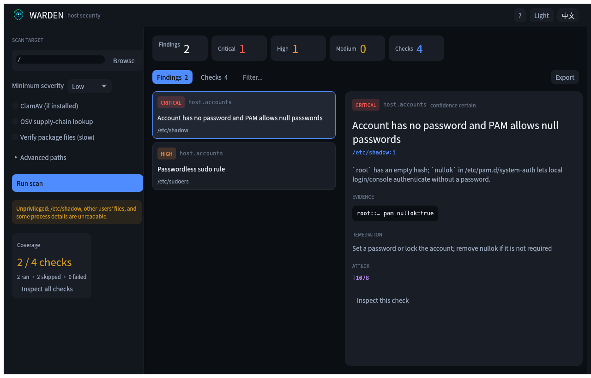
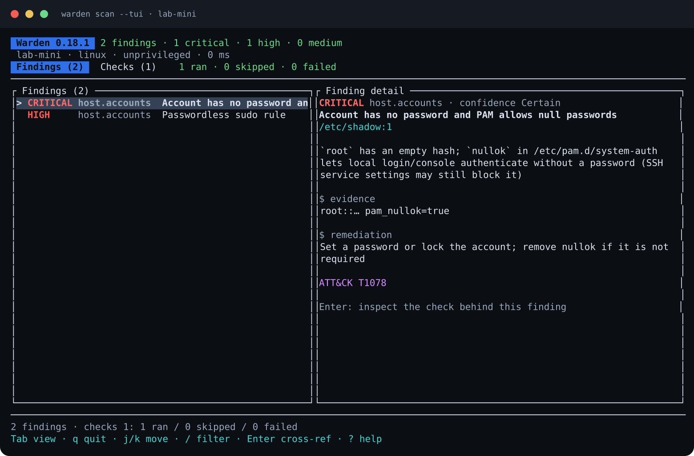

<div align="center">


# Warden

**面向 macOS / Linux 的只读主机安全扫描器。**

覆盖持久化、提权面、监听端口、签名与供应链风险，同时提供原生 GUI、终端 UI、CLI 和 Linux 沙盒。

[English](README.md) · [简体中文](README.zh-CN.md)

[](LICENSE)
[](https://www.rust-lang.org)
[](#支持平台)

</div>

## 截图

<p align="center">
  
  <br />
  <em>macOS / Linux 原生桌面应用：问题、证据与覆盖率。</em>
</p>

<p align="center">
  
  <br />
  <em>同一份报告在终端 UI 中的呈现：Findings 与完整的 Checks/覆盖率。</em>
</p>

## 它能做什么

Warden 检查攻击者在 Unix 主机上真正会利用的落点：持久化、提权、监听端口、账户配置、软件包篡改、Webshell 和已知恶意指标。每条结果都带有可验证证据：路径、行号、命令、哈希或包版本。

它**不是**只靠特征库的杀毒软件，也不是 EDR 或实时防护；不会自动删除、隔离或终止进程。它只回答一个问题：

> 这台主机的启动/登录/加载链里，有什么不该存在的东西？这个安装器到底改了什么？

## 主要能力

- **原生 GUI**（macOS / Linux）：问题、证据、检查覆盖率、JSON/SARIF 导出、深色/浅色主题、中英文界面。
- **终端 UI**：同一套 Findings，加上完整的 Checks 视图，明确显示哪些检查运行了、跳过了，以及原因。
- **24 项检查**：cron、systemd、launchd、shell rc、PAM、udev、at、SSH、动态链接器、SUID/capabilities、PATH 可写、伪装二进制、Webshell、IOC 哈希、账户、监听端口、加固状态、包完整性、OSV、恶意包、YARA、ClamAV 与 macOS 签名。
- **基线漂移与 allowlist**：把第一次扫描的噪声变成后续可回归的检查。
- **Linux 沙盒**：离线执行样本，做文件系统 diff 并给出行为评分；macOS 可通过 Lima VM 使用同一套沙盒。
- **默认只读**：扫描过程不执行被扫描代码，不修改主机配置。

## 快速开始

```bash
git clone https://github.com/yybit/warden.git
cd warden

# CLI
cargo build --release
./target/release/warden scan

# 桌面 GUI
cargo run --release -p warden-gui

# 终端 UI
./target/release/warden scan --tui
```

完整覆盖需要 root（`sudo warden scan`）：非 root 无法读取 `/etc/shadow`、其他用户的文件以及部分进程信息。GUI 会在覆盖率面板中提示这一点。

GitHub Actions 会构建 Linux / macOS、x86_64 / aarch64 的 CLI 和 GUI 包，见 [Releases](https://github.com/yybit/warden/releases/latest)。

## 文档

- [CLI 参考](docs/USAGE.md)
- [桌面应用](docs/GUI.md)
- [架构与威胁模型](docs/DESIGN.md)
- [特征来源与许可证](docs/SIGNATURES.md)

## 支持平台

Linux 与 macOS，x86_64 与 aarch64；构建需要 Rust 1.95+。GUI 基于 egui/eframe，需要桌面环境；Linux 还需要常用的 X11/Wayland 库（见 [docs/GUI.md](docs/GUI.md)）。CLI 和 TUI 没有运行时依赖；可选沙盒需要 `bubblewrap`，VM 模式需要 Lima。

## 许可证

Warden 使用 [MIT License](LICENSE)。内置的 Noto Sans SC 字体使用 SIL Open Font License 1.1，见 [apps/warden-gui/assets/fonts/OFL.txt](apps/warden-gui/assets/fonts/OFL.txt)。
